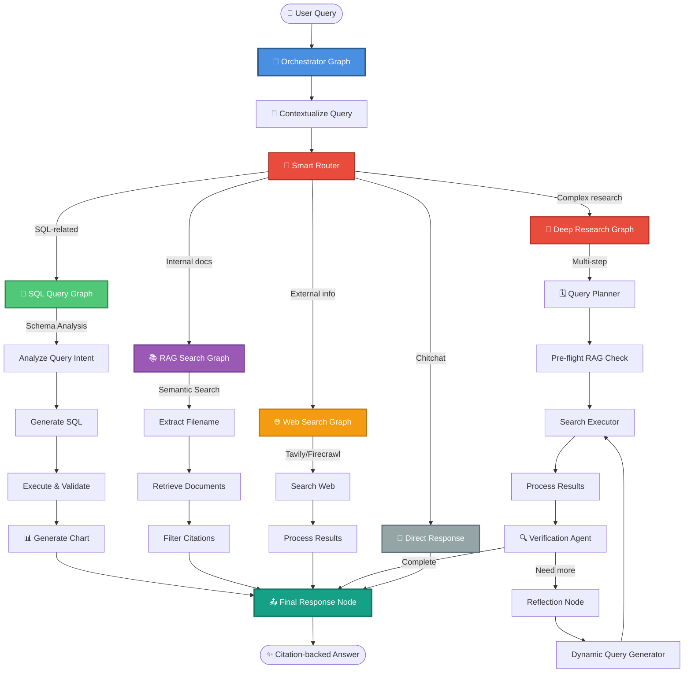

<div align="center">

<h1 align="center">
  
  Agent Research System
</h1>

<p>
  🚀 A next-generation AI research assistant powered by
  <a href="https://langchain-ai.github.io/langgraph/">LangGraph</a><br/>
  <b>Intelligent routing • Multi-agent orchestration • Citation-backed answers</b>
</p>

[](https://www.python.org/downloads/)
[](https://fastapi.tiangolo.com/)
[](https://langchain-ai.github.io/langgraph/)
[](LICENSE)

</div>

---

## 🌟 Mục tiêu

Hệ thống **Agent Research System** được xây dựng với mục tiêu tạo ra một **Knowledge Management System (KMS)** thông minh, có khả năng:

- **🎯 Định tuyến thông minh**: Tự động phân tích câu hỏi và chọn chiến lược tìm kiếm phù hợp (SQL, RAG, Web Search, hoặc Deep Research)
- **🔍 Tìm kiếm đa nguồn**: Kết hợp dữ liệu từ database nội bộ, knowledge base, và thông tin web công khai
- **🤖 Multi-agent orchestration**: Điều phối nhiều AI agent chuyên biệt làm việc cùng nhau để giải quyết câu hỏi phức tạp
- **📚 Citation-backed responses**: Mọi câu trả lời đều có nguồn trích dẫn rõ ràng, minh bạch
- **🔄 Adaptive strategy**: Tự động retry với fallback chain khi một phương pháp không hiệu quả
- **💬 Conversational context**: Hiểu ngữ cảnh hội thoại và duy trì consistency trong suốt cuộc trò chuyện

---

## 🧩 Kiến trúc tổng quan

### 📊 Flow Diagram



### 🎭 Orchestrator Pattern

Hệ thống sử dụng **Orchestrator Pattern** với các thành phần chính:

1. **🎯 Orchestrator Graph**: Điều phối toàn bộ flow
   - Contextualize query với conversation history
   - Route đến subgraph phù hợp
   - Xử lý fallback và retry logic
   - Sinh final response với appropriate mode

2. **💾 SQL Query Graph**: Xử lý truy vấn database
   - Validate relevance
   - Analyze query intent
   - Generate & validate SQL
   - Execute queries và generate charts

3. **📚 RAG Search Graph**: Tìm kiếm knowledge base nội bộ
   - Extract filename/keywords
   - Semantic search với vector database
   - Filter và rank citations

4. **🌐 Web Search Graph**: Tìm kiếm thông tin công khai
   - Multi-provider support (Tavily, Firecrawl)
   - Process và extract relevant content

5. **🔬 Deep Research Graph**: Nghiên cứu sâu đa bước
   - Query planning với adaptive strategy
   - Multi-step search execution
   - Verification và reflection
   - Dynamic query generation

---

## 🧠 Tech Stack

### 🎨 Core Framework

| Technology | Purpose | Version |
|------------|---------|---------|
| [**LangGraph**](https://langchain-ai.github.io/langgraph/) | Multi-agent orchestration framework | `0.4.8+` |
| [**LangChain**](https://python.langchain.com/) | LLM application framework | `0.3.25+` |
| [**FastAPI**](https://fastapi.tiangolo.com/) | Modern web framework | `0.115.12+` |
| [**Python**](https://www.python.org/) | Core language | `3.13+` |

### 🗄️ Data Storage & Processing

| Technology | Purpose |
|------------|---------|
| **PostgreSQL** | Primary relational database |
| **Qdrant** | Vector database for semantic search |
| **MinIO** | Object storage for documents |
| **Redis** | Caching & session management |
| **Alembic** | Database migration tool |
| **SQLAlchemy** | ORM and database toolkit |

### 🤖 AI & Machine Learning

| Technology | Purpose |
|------------|---------|
| **Anthropic Claude** | Primary LLM provider |
| **OpenAI GPT** | Alternative LLM provider |
| **LiteLLM** | Unified LLM interface |
| **FastEmbed** | Fast embedding generation |
| **HuggingFace** | Model hosting & embeddings |
| **Graphiti-Core** | Knowledge graph management |

### 🔧 Infrastructure & DevOps

| Technology | Purpose |
|------------|---------|
| **Docker** | Containerization |
| **Celery** | Distributed task queue |
| **Prometheus** | Metrics & monitoring |
| **OpenTelemetry** | Distributed tracing |
| **Uvicorn** | ASGI server |
| **Nginx** | Reverse proxy & load balancer |

### 📄 Document Processing

| Technology | Purpose |
|------------|---------|
| **Unstructured** | Multi-format document parsing |
| **PyMuPDF** | PDF processing |
| **python-docx** | Word document processing |
| **openpyxl** | Excel file processing |
| **python-pptx** | PowerPoint processing |
| **PDFPlumber** | Advanced PDF extraction |

### 🔍 Search & Retrieval

| Technology | Purpose |
|------------|---------|
| **Tavily** | Web search API |
| **Firecrawl** | Web scraping & crawling |
| **LangChain Retrievers** | Document retrieval strategies |
| **Custom Reranking** | Search result optimization |

### 🛠️ Utilities & Tools

| Technology | Purpose |
|------------|---------|
| **Pydantic** | Data validation & settings |
| **FastMCP** | Model Context Protocol |
| **Tiktoken** | Token counting & management |
| **TheFuzz** | Fuzzy string matching |
| **APScheduler** | Job scheduling |
| **Pre-commit** | Git hooks & code quality |
| **Ruff** | Fast Python linter |

---

## ✨ Key Features

### 🎯 Intelligent Query Routing

Hệ thống tự động phân tích và route câu hỏi đến subgraph phù hợp nhất:

- **SQL queries**: "How many users signed up last month?"
- **Internal docs**: "What is our vacation policy?"
- **Web search**: "Latest AI trends in 2025"
- **Deep research**: "Analyze market expansion opportunities"
- **Direct response**: "Hello, how are you?"

### 🔄 Adaptive Fallback Chain

Nếu một subgraph không trả về kết quả hữu ích, hệ thống tự động:
1. Thử subgraph tiếp theo trong fallback chain
2. Retry với router để chọn strategy khác
3. Giới hạn retry để tránh vòng lặp vô hạn

### 📚 Multi-Source Knowledge Integration

Kết hợp seamless giữa:
- **Structured data**: PostgreSQL database
- **Unstructured docs**: Vector database (Qdrant)
- **Web knowledge**: Real-time web search
- **Knowledge graph**: Graphiti for entity relationships

### 🔍 Citation & Traceability

Mọi câu trả lời đều bao gồm:
- Source documents với page numbers
- Confidence scores
- Search metadata
- Execution history

### 🚀 Performance Optimization

- **Redis caching**: LLM response caching
- **Connection pooling**: Database connection management
- **Rate limiting**: API protection
- **Streaming responses**: Real-time answer generation
- **Async operations**: Non-blocking I/O

---

## 🚀 Getting Started

### Prerequisites

- Python 3.13+
- Docker & Docker Compose
- PostgreSQL 14+
- Redis 7+
- MinIO
- Qdrant

### Installation

```bash
# Clone repository
git clone <repo-url>
cd BEFinalProject

# Install dependencies with uv
uv sync

# Setup environment variables
cp .env.example .env
# Edit .env với your API keys và configuration

# Start infrastructure services
docker-compose -f docker/docker-compose.yml up -d

# Run database migrations
alembic upgrade head

# Start the server
python src/main.py
```

### 📖 API Documentation

Sau khi start server, truy cập:
- **Swagger UI**: http://localhost:8000/docs
- **ReDoc**: http://localhost:8000/redoc
- **Health Check**: http://localhost:8000/health

---

## 📝 Project Structure

```
BEFinalProject/
├── src/
│   ├── agents/              # Multi-agent system
│   │   ├── basic/          # Basic agents (query context, response, etc.)
│   │   ├── graph/          # Subgraph implementations
│   │   ├── com/            # Communication layer (registry, prompts)
│   │   └── executors/      # Subgraph executors
│   ├── api/                # FastAPI endpoints
│   ├── auth/               # Authentication & authorization
│   ├── config/             # Configuration management
│   ├── db/                 # Database models & repositories
│   ├── rag/                # RAG components (embedding, retrieval)
│   ├── services/           # Business logic services
│   ├── tasks/              # Celery tasks
│   └── utils/              # Utility functions
├── alembic/                # Database migrations
├── docker/                 # Docker configuration
├── etc/                    # Configuration files
└── logs/                   # Application logs
```

---

## 🤝 Contributing

Contributions are welcome! Please feel free to submit a Pull Request.

---

## 📄 License

This project is licensed under the MIT License - see the [LICENSE](LICENSE) file for details.

---

<div align="center">


### _"The best research agents don't just find answers — they understand questions."_

Made with ❤️ using LangGraph & FastAPI

</div>